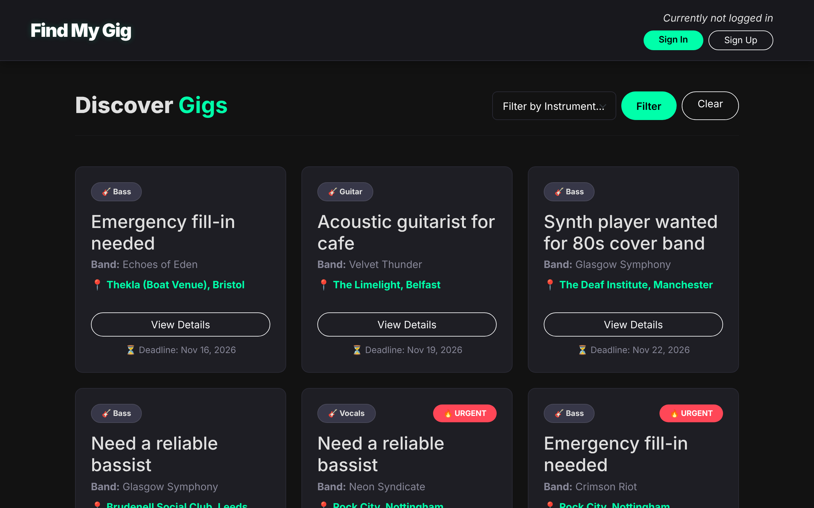

# Find My Gig

A Django web app where bands post gigs and musicians find, apply for and review them.




## Why it is useful

- Bands get one place to post open spots with the instrument needed, location and deadline.
- Musicians can filter open gigs by instrument and date instead of scrolling through social media groups.
- Bands can browse musicians and contact them directly.
- Reviews on both sides give each profile a track record.

## Features

- Two account types, musician and band, with sign-up, login, logout and email password reset.
- Gig listings with instrument filter, date filter and sort by name or deadline.
- Gig detail page with a Google Map of the venue.
- Musicians apply to a gig, withdraw, and bookmark gigs for later.
- Bands create and delete their own listings from a dashboard.
- Bands browse musicians (filter by instrument) and send them a reach-out message. Musicians read and delete these in an inbox.
- Reviews between musicians and bands, tied to a gig, with a rating from 0 to 5 and a community badge based on review count.
- Editable profiles: bio, picture, instruments, age and media links. Account deletion.
- Demo data script that seeds 10 bands, 30 musicians, gigs, applications and reviews.

## How it works

Server-rendered Django app with one app, `gigs`.

- `models.py`: `Musician`, `Band`, `Listing`, `Application`, `Review`, `MediaLink`, `BandInterest`.
- `views.py`: page views plus small JSON endpoints for apply, withdraw, bookmark, create listing and reach-out. The browser calls them with `fetch` from the scripts in `static/find_my_gig/js/`.
- `Listing.save()` geocodes the location through the Google Geocoding API and stores latitude and longitude. The map on the gig page reads those values.
- Without Google Maps keys the app still runs: geocoding is skipped and maps show a placeholder.
- WhiteNoise serves static files in production. Uploaded profile pictures are served by Django when `DEBUG=true`.
- Database: SQLite.

## Tech stack

- Backend: Python, Django 4.2, SQLite
- Frontend: Django templates, Bootstrap 5 (CDN), vanilla JavaScript
- APIs: Google Maps JavaScript and Geocoding (optional)
- Serving: gunicorn, WhiteNoise
- CI and deploy: GitHub Actions (Python 3.12), Render

## Run locally

Needs Python 3.12 or newer.

```bash
git clone https://github.com/yehorm14/find-my-gig
cd find-my-gig
python -m venv .venv
source .venv/bin/activate          # Windows: .venv\Scripts\activate
pip install -r requirements.txt

cp .env.example .env
# Put a generated key into DJANGO_SECRET_KEY in .env:
python -c "from django.core.management.utils import get_random_secret_key; print(get_random_secret_key())"

python manage.py migrate
python population_script.py        # optional demo data
python manage.py runserver
```

Open http://127.0.0.1:8000/. With demo data, log in as `musician_1` or `band_user_1`, password `Password123!`.

Settings come from environment variables or `.env` (see `.env.example`):

| Variable | Purpose |
| --- | --- |
| `DJANGO_SECRET_KEY` | Required. |
| `DEBUG` | `true` for local development. Defaults to false. |
| `ALLOWED_HOSTS`, `CSRF_TRUSTED_ORIGINS` | Comma-separated lists. |
| `GOOGLE_MAPS_FRONTEND_KEY`, `GOOGLE_MAPS_BACKEND_KEY` | Optional. Enable maps and geocoding. |
| `EMAIL_USER`, `EMAIL_PASS` | Optional. Without them reset emails print to the console. |

The demo script downloads profile pictures from picsum.photos and skips them if offline. It only seeds an empty database. Use `python population_script.py --reset` to delete all non-admin users and reseed.

With `DEBUG=false`, run `python manage.py collectstatic --noinput` first, then serve with `gunicorn find_my_gig.wsgi`. `render.yaml` describes this setup for Render.

## Tests

57 tests: `python manage.py test` (needs `DJANGO_SECRET_KEY` set). Tests cover models, URL routing, views and the geocoding fallback. They do not call the Google API.

## Team and my role

Built as a team project for the University of Glasgow Web App Development course (2026), January to March 2026. This repository is Yehor Mykhailov's maintained copy of the team repository.

Team, as named in the commit history: Yehor Mykhailov (`yehorm14`), Ross, Cruz, Akif Baig (`AkifBaig01`), Mackenzie Trafford (`mushypea`).

What Yehor built:

- About 70% of the surviving application code by `git blame` (about 3,900 of 5,400 lines in `gigs/`, `templates/`, `static/`, project settings and the population script, excluding migrations). He also has the largest share of lines added over the history. By commit count Ross has the most (57 non-merge commits against 47 for Yehor), mostly template and UI fixes.
- `gigs/views.py` (about two thirds of the lines): listings, filters, dashboards, apply, bookmark, reach-out and review logic.
- `gigs/models.py` additions, including Google Maps geocoding and mini-maps, plus forms and URL routing.
- The demo data script, most of the test suite, and the template and CSS refactor.
- Later cleanup in this copy: configuration from environment variables, static file serving, optional Maps keys, CI and deployment config.

Ross wrote most of the first templates, JavaScript and UI fixes. Cruz wrote the first models and the login, logout and password reset flows. Akif Baig added URL and form work. Mackenzie Trafford contributed CSS.

## Limitations and next steps

- SQLite on Render's free tier is not persistent. The demo data is reseeded on each deploy.
- Bootstrap loads from a CDN, so the pages are unstyled offline.
- Interactions use JSON endpoints with hand-written `fetch` code and no API documentation.
- No pagination on listings, and no notification when a band reviews a musician or a gig changes.

## Credits / Licence

- Google Maps JavaScript and Geocoding APIs.
- Bootstrap 5 and Bootstrap Icons.
- Demo profile pictures from picsum.photos.
- No licence file is included. All rights reserved by the authors.
