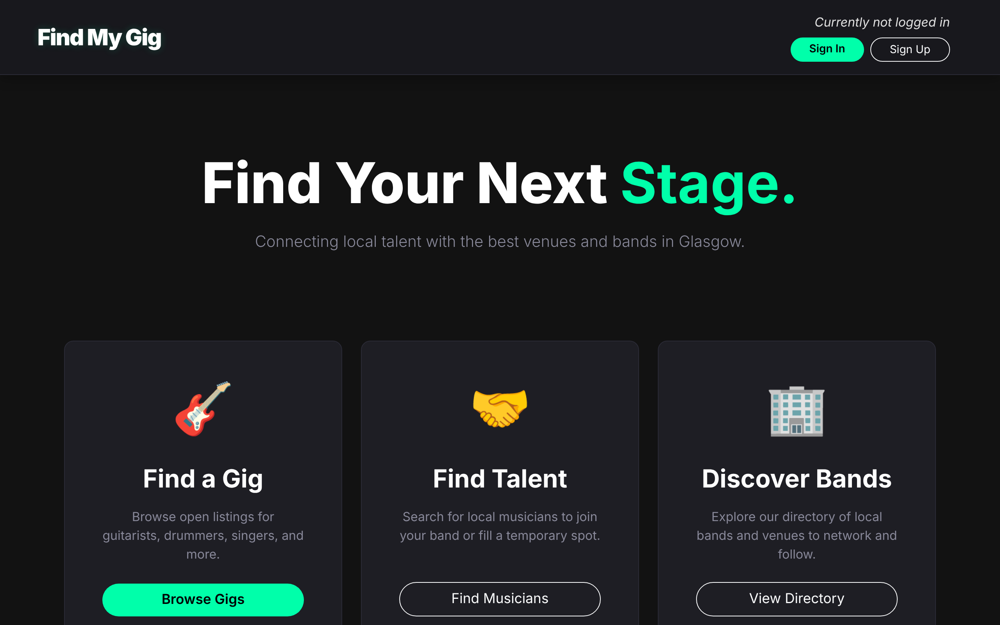
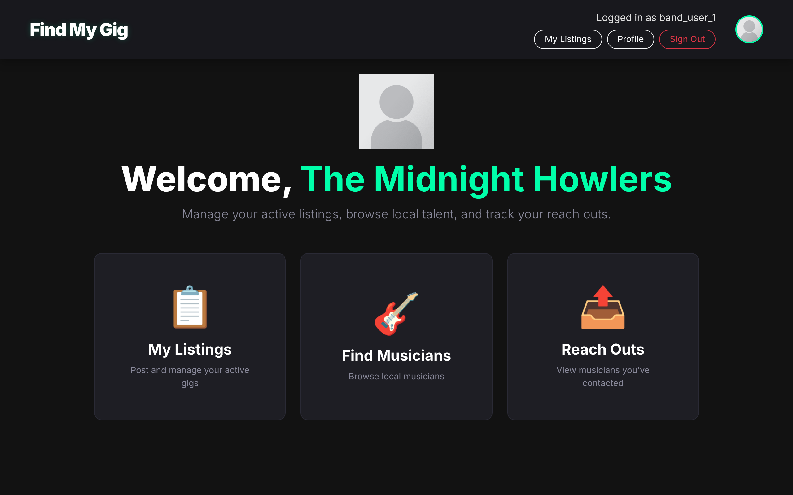

# Find My Gig

[](https://github.com/yehorm14/find-my-gig/actions/workflows/ci.yml)


A Django web app where bands post gigs and musicians find, apply for and review them.


## Screenshots

| Home | Band dashboard |
| --- | --- |
|  |  |

## Why it is useful

- Bands post open spots with instrument, location and deadline in one place.
- Musicians filter open gigs by instrument and date.
- Reviews on both sides build a track record for each profile.

## Features

- Musician and band accounts with sign-up, login and email password reset.
- Gig listings with instrument and date filters and a Google Map on each gig.
- Musicians apply, withdraw and bookmark gigs.
- Bands create and delete listings from a dashboard.
- Bands browse musicians and send reach-out messages to an inbox.
- Ratings (1 to 5) and comments between musicians and bands, tied to a gig.
- Editable profiles with picture, instruments and media links.

## How it works

- One Django app, `gigs`, rendering server-side templates with SQLite storage.
- JSON endpoints handle apply, bookmark, create listing and reach-out. Vanilla JS calls them with `fetch`.
- `Listing.save()` geocodes the location with the Google Geocoding API. Without keys, geocoding is skipped and maps show a placeholder.

## Tech stack

- Backend: Python, Django 4.2, SQLite, gunicorn, WhiteNoise
- Frontend: Django templates, Bootstrap 5, vanilla JavaScript
- APIs: Google Maps JavaScript and Geocoding (optional)
- Tooling: GitHub Actions (Python 3.12), Render

## Run locally

```bash
git clone https://github.com/yehorm14/find-my-gig && cd find-my-gig
python -m venv .venv && source .venv/bin/activate
pip install -r requirements.txt
cp .env.example .env        # then set DJANGO_SECRET_KEY, see docs/DEPLOY.md
python manage.py migrate
python population_script.py # optional demo data
python manage.py runserver
```

Open http://127.0.0.1:8000/. Demo logins: musician `musician_1`, band `band_user_1`, password `Password123!`. Configuration and deployment: [docs/DEPLOY.md](docs/DEPLOY.md).

The app is set up for deployment on Render (see `render.yaml`); [docs/DEPLOY.md](docs/DEPLOY.md) has the details.

## Tests

71 tests: `python manage.py test` (needs `DJANGO_SECRET_KEY` set).

## Team and my role

Built by Team 1E for the University of Glasgow Web App Development course (January to March 2026). This is Yehor Mykhailov's maintained copy of the team repository.

Team: Yehor Mykhailov ([`yehorm14`](https://github.com/yehorm14)), Ross, Cruz, Akif Baig ([`AkifBaig01`](https://github.com/AkifBaig01)), Mackenzie Trafford ([`mushypea`](https://github.com/mushypea)).

Yehor was the main developer (91 of 184 commits on the original team history). What he built:

- About 75% of the surviving application lines (Python, JavaScript, CSS and templates) by `git blame`, including most of `views.py` and `urls.py`, the Google Maps geocoding, and the forms.
- The demo data script and most of the test suite (about 94% of surviving test lines).
- A refactor of the templates and logic, and later the environment-based configuration, CI and Render setup.

Teammates:

- Ross: JavaScript files, settings, and template updates (base, home, profile, login).
- Cruz: the initial models, the first population script and the model tests.
- Akif Baig: login, logout, sign-up and password reset, with the related URLs and forms.
- Mackenzie Trafford: the first base template, most of the original templates, and the CSS.

## Credits

Google Maps APIs, Bootstrap 5 and Bootstrap Icons, demo pictures from picsum.photos.
